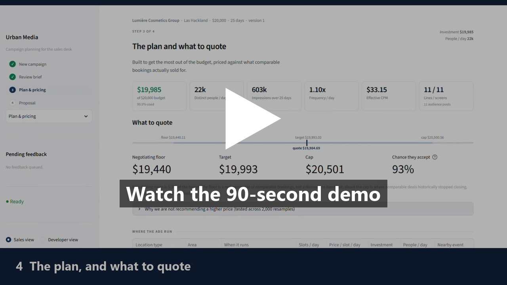

# Urban Media — Commercial Intelligence Platform

Team 091 · Agentic AI Hackathon 2026 · *The AgentIQ Frontier*

A decision system for a Digital-Out-Of-Home advertising business. It takes a
client brief as a Word document and returns a media plan a salesperson can
send: which of **11,163 screens** to book, in which time blocks, at what price,
with the reach and frequency that plan actually buys — and a written account of
why, including what it could **not** do.

[](https://youtu.be/AtGTnpdT2Gc)

▶ **[Demo (90 seconds)](https://youtu.be/AtGTnpdT2Gc)** · 📖 [Full walkthrough (10 min)](https://youtu.be/1EFneOp2JrU)

> **Status: code-only release.** This is a hackathon project built by a
> team in the Agentic AI Hackathon 2026 at my company. The datasets supplied for the
> event are not redistributed, so the app will not run end to end from this
> repo alone. The demo and walkthrough videos above show the working
> application. All API keys used during the event have been
> revoked; no credentials are included.
>
> **My contribution:** the Streamlit application (D6), the relevance scoring
> pipeline (D2) and part of the pricing model (D3).
>
> **Team:** Team 091 . Original development happened in an internal repository.

See [PROBLEM_STATEMENT.md](PROBLEM_STATEMENT.md) for the challenge this answers.

Six deliverables, one pipeline:

| | Deliverable | What it produces | Technique |
|---|---|---|---|
| **D1** | Audience Profile Engine | Deduplicated audience pools per screen × time block | Feature engineering over footfall, transit and POI tables |
| **D2** | Campaign–Screen Relevance Scorer | A 0–1 relevance score per candidate, with reasons | Weighted multi-signal scoring |
| **D3** | Demand Forecasting & Pricing | A quote band (floor / target / cap) and win probability | Censored win/loss elasticity + a `GradientBoostingRegressor` blended by credibility |
| **D4** | Impressions Optimizer | The booked line set | CP-SAT integer program over a concave reach envelope |
| **D5** | Agentic Orchestration | The plan, the refusals, and the agent's decision log | Bounded hill-climb over a closed lever menu |
| **D6** | Unified Platform | The six-screen application a rep uses | Streamlit |

---

## Quick start — the application

```powershell
.\run_app.ps1
```

That creates the virtual environment, installs the pinned dependencies, checks
the data files are present, picks a free port, and opens the app.

**No credentials are required.** Without a `.env` the platform is fully
functional: every model-assisted path falls back to a deterministic one that is
always built and always correct. To enable the model paths, copy `.env.example`
to `.env` and fill it in.

First launch takes about 10 seconds to warm up — nine CSVs, the rate card, and
one regression per corridor over a 129 MB ridership table. That happens on a
background thread while you read the brief, so the first two screens are usable
immediately.

### Manual setup, if you prefer

```powershell
python -m venv .venv
.venv\Scripts\python.exe -m pip install -r requirements.txt
.venv\Scripts\python.exe -m streamlit run app/main.py
```

Python 3.13. `requirements.txt` carries **exact pins**, not floors — two of them
change numeric output rather than just API surface, and the reproducibility
claim below is only meaningful against a known stack.

---

## Running the engines directly

Every engine is runnable on its own. The orchestrator is the interesting one:

```powershell
# Plan one brief, with the written explanation
python build_d5_orchestrator.py --brief campaign_1.docx.parsed.txt --narrate

# All six briefs (globs campaign_*.docx.parsed.txt)
python build_d5_orchestrator.py

# Useful flags
#   --day-type weekend        solve the weekend split instead of the weekday one
#   --force-greedy            skip CP-SAT, use the greedy fallback (for comparison)
#   --no-llm-intake           disable every model call; pure deterministic path
#   --campaign-start/-end     date-aware pricing over a specific flight
```

Others:

```powershell
python build_d1_audience_profiles.py     # rebuild the audience cube
python build_d2_relevance_scorer.py      # score screens against the briefs
python pricing_engine_d3.py              # rebuild the rate card + train the GBM
python build_d4_allocator.py             # the allocator on its own
python extract_briefs.py                 # .docx briefs -> the .txt form D2 parses
python price_sensitivity_d3.py           # the expected-revenue curve (offline)
python feedback_capture.py --seed        # regenerate the sample rep feedback
python llm_agent.py --journal            # the LLM spend ledger
python llm_agent.py --check-network      # is the API reachable from here?
```

---

## Tests

Plain modules, no `pytest` — nothing to install beyond `requirements.txt`.

```powershell
# Engine gate. Required before any D1-D5 change lands.
python test_pipeline.py                  # 69 checks, no network, no spend
python test_pipeline.py --fast           # skips the plan-building checks

# Application
.venv\Scripts\python.exe -m app.tests.test_intake_parity   # .docx extraction == reference
.venv\Scripts\python.exe -m app.tests.test_app_units       # db, router, learning, metrics
.venv\Scripts\python.exe -m app.tests.test_ui_screens      # every screen, both modes
.venv\Scripts\python.exe -m app.tests.smoke_pipeline 4     # one brief end to end
.venv\Scripts\python.exe -m app.tests.smoke_rfp all        # all six -> proposals on disk
```

Each of the 69 engine checks exists because the property it asserts was once
broken while still looking fine — a fallback documented in three places that had
never executed, a frequency objective scoring a constant zero, a shortlist
starving the optimiser of audience diversity.

---

## What it produces, on the six real briefs

Reach is deduplicated people per day; campaign 2 optimises frequency instead, so
its figure is exposures per person.

| # | Client | Objective | Result | Solver |
|---|---|---|---|---|
| 1 | Zephyr EV | reach | 137,252 | proven optimal |
| 2 | Ember Energy | frequency | 14.59 exposures/person | proven optimal |
| 3 | Loom & Thread | reach | 201,328 | proven optimal |
| 4 | Basil & Bloom | reach | 76,446 | proven optimal |
| 5 | Skynimbus | reach | ~134,880 | **feasible, not proven** |
| 6 | Lumière Cosmetics | reach | 30,788 | proven optimal |

**Campaign 5 is the honest exception.** It is the largest problem of the six and
it exhausts the 20-second solve limit, so CP-SAT returns the best plan it found
rather than a proven optimum. A timeout-bound solve is decided by wall clock, so
its reach moves slightly between runs (134,873 and 134,889 on two observed runs
— about 0.01%). The other five are reproducible to the cent, which the suite
asserts, and which is why `build_d4_allocator.py` pins a search seed and breaks
objective ties on revenue rather than arbitrarily.

Two consequences worth knowing before a demo. The revenue tie-break only applies
on a *proven* optimum, so campaign 5 does not get it. And because reproducibility
depends on solves finishing inside the limit, a busy machine makes more of them
land in `FEASIBLE`. Raise `D6_SOLVE_TIME_LIMIT_S` if you need campaign 5 proven;
the trade is wall clock.

---

## How the agent works

D5 runs a **bounded hill-climb**, not an open-ended loop:

1. **Observe** — measured state. No model involved.
2. **Decide** — the model picks *one* lever from a closed menu of four, or stops.
3. **Act** — re-solve with that lever applied.
4. **Measure** — keep the result only if it beats the best so far on *this
   brief's own objective*. Otherwise revert.

Termination is structural: a hard iteration bound, and each lever may be used
once. A lever can therefore never make a plan worse, which is what makes trying
one free.

Every step records what a **fixed rule** would have chosen instead. That
counterfactual is how we tell the reasoning is earning its place — it is what
caught the model accepting a plan the rule improved by 4.8%. The application
renders the whole log on the proposal screen, including the steps that were
reverted and the briefs where nothing improved on the first solve.

**The model never computes a number.** It reads text and writes prose; it never
prices, scores, allocates or chooses inventory. That boundary is structural, not
a convention: `llm_agent.py` is the only module in the repository that holds an
API client, and it fences every call on four axes — dollars, tokens, prompt size
and call count — checked *before* dispatch, so a refused call spends nothing.

---

## Documentation

| File | What it covers |
|---|---|
| [`C4_SYSTEM_DESIGN.html`](C4_SYSTEM_DESIGN.html) | **System design** — C4 Context, Container and Component diagrams, design decisions with measured consequences, known limits. Self-contained; open it in a browser. |
| [`CLAUDE.md`](CLAUDE.md) | AI coding context: the layering rule, the traps, the two cost guards |
| [`D6_APP_DESIGN.md`](D6_APP_DESIGN.md) | Screen-by-screen rationale for the application |
| [`docs/COMPETITION_TOOLKIT.md`](docs/COMPETITION_TOOLKIT.md) | The supplied toolkit's own README, kept for reference |

---

## Limits we state rather than hide

A plan that quietly implies it met a requirement it could not meet is worse
than one that refuses. These are surfaced in the product, not buried here:

- **D3's recommended price is the revenue optimum by construction.** The
  identified comparison lives inside `lost_leads`, and with 760 observations the
  elasticity puts the optimum at `P(win) = 93%` — exactly where quotes already
  land. Moving it would mean assuming a flatter curve than the data supports.
  The honest deliverable is a sensitivity band, which is what `price_sensitivity_d3.py`
  produces.
- **No walking-radius filtering.** The screen tables carry no coordinates, so a
  brief asking for "screens within walking distance of the new outlet" gets an
  explicit warning instead of a silently wrong answer.
- **No orientation or aspect ratio.** `screens.csv` has size and position; a
  brief specifying a creative format cannot be filtered on it.
- **`day_type` is averaged out of the quote key**, so weekday/weekend pricing is
  a blend. D2 detects briefs needing a split; the application closes it by
  solving twice.
- **Three of six briefs never name a city.** That is a blocking clarification in
  the product, not a guess.
- **The agent is legitimately inert on some briefs.** Where nothing was withheld
  and the first solve is already optimal, there is nothing for a lever to
  improve, and the log says so.

---

## Environment

Requires the **company network** (office Wi-Fi or VPN) for the API and the
repository. A `403` with *"Access denied due to Virtual Network/Firewall
rules."* means off-network — not a bad key. `python llm_agent.py --check-network`
distinguishes the two.

The API key is shared across the team. It lives in `.env`, which is
git-ignored and has never been committed. Never paste it anywhere public.
